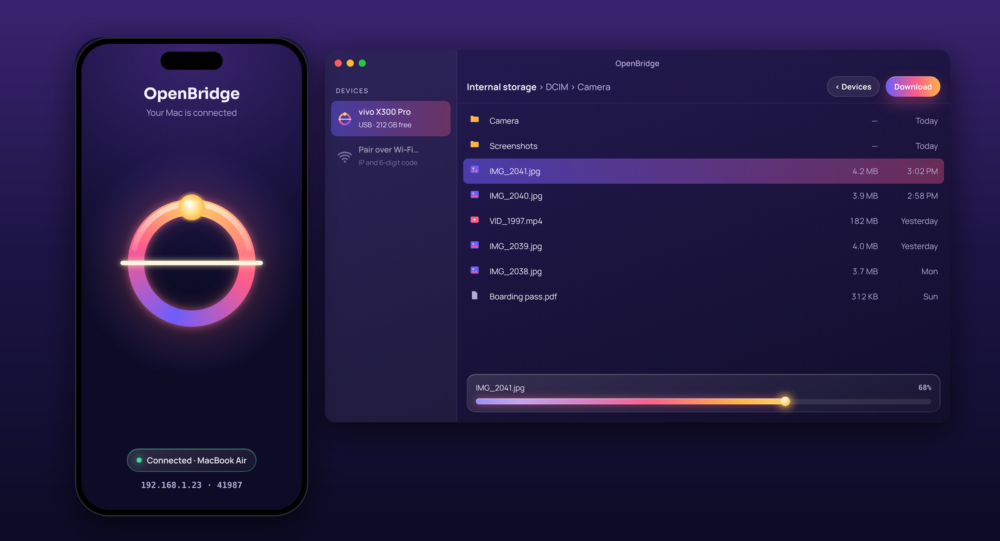

<p align="right"><a href="README.zh-CN.md">简体中文</a></p>

<p align="center"></p>

# OpenBridge

[](https://github.com/PredatorWoah/OpenBridge/releases/latest)
[](LICENSE)




**OpenBridge moves files and text between your Android phone and your Mac, Windows PC or Linux computer.** Free, open source, and private: no account, no cloud, no tracking. Everything goes straight from one device to the other, over your Wi‑Fi or a cable.

- 🔌 **Plug in and it opens.** Choose File transfer on the phone and OpenBridge opens it in its own window on the Mac and on Windows, with shortcuts to Camera, Download, Screenshots, WhatsApp and Documents. No drivers, no kernel extensions, no macFUSE.
- ⚡ **Fast USB.** Turn on USB debugging once and the cable gets everything Wi‑Fi has: instant search, real folder sizes, and copies that continue after an interruption.
- ☀️ **Tap to share over Wi‑Fi.** Tap the big button on the phone. Your computer finds it by itself; pair once by checking that both screens show the same 6 digits, and from then on it reconnects without asking.
- 🔒 **Encrypted and pinned.** Every Wi‑Fi request uses TLS with the phone's certificate pinned, and each computer has its own secret you can revoke on the phone.
- 🗂️ **A real file browser.** Thumbnails and a grid, Quick Look (Mac), sorting, multi-select, whole folders both ways, drag and drop, new folders, rename and delete, folder sizes, and search across the whole phone. Photos and videos turn up instantly.
- 📤 **Send from the phone.** Share › OpenBridge in any app sends photos and files to your computer's *Downloads/OpenBridge*. Big videos go straight from where they are, without a copy eating your storage.
- 💬 **Texts and clipboard.** Share text to OpenBridge, tap the **Send clipboard** tile, or type on the computer and send it to the phone. It lands on the other clipboard, with a history of what went where. Optionally, text you copy on the computer goes to the phone by itself.
- 📸 **Import new photos.** One click copies only the camera photos and videos you haven't imported yet.
- 📺 **Screen mirroring.** See and control your phone in a window, powered by [scrcpy](https://github.com/Genymobile/scrcpy). Start on the cable, then go wireless and unplug.
- 📶 **Works on awkward Wi‑Fi.** Hotel, campus and guest networks often keep devices apart. OpenBridge notices and offers the way round: the phone's own hotspot, or the cable.
- 🎨 **Three looks.** Dusk (the original sunset), plus Aurora and Tide, two fluid animated looks in preview, on the phone and the computer.
- 🐘 **Big files are fine.** 4 GB and more both ways; an interrupted download or upload continues where it stopped.
- 🛡️ **Never overwrites.** Existing files are never replaced on either side.
- 🔔 **Updates itself.** When a new version is out, one click downloads it, checks it against the release's checksums and installs it.
- 🌏 **English and 简体中文** on the phone and on Windows and Linux. Works with any Android phone, Xiaomi, OPPO, vivo, OnePlus and Honor included, with or without Google services.

## Download

Get everything from the [latest release](https://github.com/PredatorWoah/OpenBridge/releases/latest). See the [changelog](CHANGELOG.md) for what's new.

| Device | File | How to install |
| --- | --- | --- |
| Android 8 or later | `OpenBridge-<version>.apk` | Open it on the phone and allow installing from your browser or file manager when asked. |
| Mac, macOS 13 or later (Apple Silicon and Intel) | `OpenBridge-<version>-macOS.dmg` | Open it and drag OpenBridge to Applications. It isn't notarized, so the first time right-click the app › **Open** › **Open**. If macOS says it's damaged, run `xattr -dr com.apple.quarantine /Applications/OpenBridge.app`. |
| Windows 10 or 11 (64-bit) | `OpenBridge-<version>-Windows-Setup.exe` | Run it; it installs for your account, no administrator needed. It isn't code-signed yet, so if SmartScreen warns, click **More info › Run anyway**. Prefer no installer? Unzip `-Windows.zip` and run `OpenBridge.exe`. |
| Linux (x86-64) | `OpenBridge-<version>-Linux-amd64.deb` or `-Linux-x86_64.tar.gz` | `sudo apt install ./OpenBridge-<version>-Linux-amd64.deb` on Debian and Ubuntu, or unpack the tar.gz anywhere and run `OpenBridge/bin/OpenBridge`. |

Every release lists its files' SHA-256 in `SHA256SUMS.txt`, and the APK is signed with the OpenBridge key whose fingerprint is in [SECURITY.md](SECURITY.md#verifying-downloads).

## Getting started


1. **On the phone,** open OpenBridge and tap the big button. The first time, allow *All files access* (or choose one folder to share instead).
2. **On the computer,** open OpenBridge. Your phone shows up under **Phones nearby**; click it.
3. **Compare the 6 digits** on both screens and tap **Pair** on the phone if they match. That's it: browse, drag files in and out, and next time it connects by itself.

Prefer a cable? Plug in, unlock the phone and choose **File transfer**. The Mac and Windows apps open it straight away, no pairing needed.

## Ways to connect

| | Wi‑Fi | USB cable (File transfer) | Fast USB | Phone hotspot |
| --- | --- | --- | --- | --- |
| Set up | Pair once with a 6-digit code | Nothing: choose File transfer | Turn on USB debugging once | Turn on in the phone app (Android 13+) |
| Needs the phone app | Yes | No | Yes | Yes |
| Speed | Your Wi‑Fi's | Cable | Cable | Phone's Wi‑Fi |
| Search and folder sizes | Instant | Counted over the cable | Instant | Instant |
| Texts, send from phone, resuming | Yes | Mac: resuming downloads | Yes | Yes |
| Encrypted | TLS | No (like any USB File transfer) | TLS | TLS |
| Computers | Mac, Windows, Linux | Mac, Windows | Mac, Windows, Linux | Mac, Windows, Linux |

**Fast USB** runs the same encrypted connection as Wi‑Fi through the cable, using Android's USB debugging. Turn it on once (Settings › About phone › tap **Build number** seven times, then Developer options › **USB debugging**), plug in, and tap **Allow** on the phone. OpenBridge starts sharing on the phone by itself and switches to Fast USB. Wi‑Fi isn't needed.

**Phone hotspot** is for networks that keep devices apart (common in hotels, offices, campuses and guest Wi‑Fi). On the phone, open **Settings › Phone hotspot**, join the network it shows from your computer, and it connects. On Android 12 and earlier the button opens the system hotspot settings instead.

**USB tethering** also works: turn it on on the phone and tap the button; OpenBridge prefers the cable. macOS doesn't support the RNDIS tethering some phones use, so on a Mac use File transfer or Fast USB instead.

## What you can do

### Browse and transfer

Double-click folders to open them, switch between list and grid, sort by name, size or kind, and filter to photos and videos. Folder sizes fill in as the phone counts them. Select with ⌘ or Ctrl and ⇧ or Shift, then **Download**; several items go into a folder you choose, keeping their structure. Drop files or folders onto the window to upload. Rename and delete from the right-click or **⋯** menu (OpenBridge asks first, because the phone has no bin). The keyboard works too: arrows, Enter to open, Backspace to go up, Delete, F2 to rename, and Ctrl/⌘+A.

**Search** looks through the whole folder you're in, every subfolder included: type and press Return. Photos, videos and music come back instantly from the phone's own index; other files within a few seconds.

If a transfer is interrupted, **Resume** continues it from where it stopped, and reconnecting picks it up by itself.

### Send from the phone

In the gallery, Files or any app, select photos or files and tap **Share › OpenBridge**. They arrive in **Downloads/OpenBridge** on your computer as soon as it's connected, or the next time it is. If sharing is off, OpenBridge starts it. Large videos are sent from where they are, so sharing a 4 GB video doesn't need 4 GB of free space.

### Texts and clipboard

- **Phone to computer:** share text to OpenBridge from any app, tap the **Send clipboard** quick-settings tile (or the button in the app, or in the sharing notification). It's on your computer's clipboard a moment later.
- **Computer to phone:** open **Texts**, type or paste, and **Send**; or **Send clipboard**. Turn on **Send copied text to the phone automatically** to skip the button.
- Both sides keep a short history of texts with a Copy button. Nothing leaves your two devices.

### Import new photos

**Import new photos** (on the phone's card or in **⋯**) copies the camera's photos and videos you haven't imported from that phone yet into a folder you pick once, and remembers them.

### Screen mirroring

See your phone's screen in a window and use it with the mouse and keyboard, with the open-source [scrcpy](https://github.com/Genymobile/scrcpy) built in. Turn on USB debugging (as for Fast USB), plug in and click **Mirror screen**. Then **Go wireless** (Mac) or **Mirror over Wi‑Fi** (Windows, Linux) and unplug. Text you copy on either side is copied to the other. USB debugging gives a trusted computer broad control of the phone; see [SECURITY.md](SECURITY.md#screen-mirroring-usb-debugging) and turn it off when you don't need it.

### Looks

Pick **Dusk**, **Aurora** or **Tide** in Settings on each device. Aurora's ribbons drift across a starry sky and its halo shimmers; in Tide the waves roll and the glass pool fills with water when your computer connects. Aurora and Tide are in preview: tell us what you think. With your system's reduce-motion setting on, the backgrounds hold still.

### Updates and help

Each app checks GitHub once per launch. When there's a new version, click **Update**: it's downloaded, checked against the release's `SHA256SUMS.txt`, and installed (on Android, the system asks you to confirm). Something not working? **Settings › Copy diagnostics** copies a short report, with no secrets or file contents, to paste into an [issue](https://github.com/PredatorWoah/OpenBridge/issues/new/choose).

## Why OpenBridge

Apple and Android don't talk to each other out of the box, and Microsoft's Phone Link needs an account and works best with a few brands. Most people end up with a paid app, a cloud service, or Google's old Android File Transfer, which Google has discontinued.

| | OpenBridge | Typical alternatives |
| --- | --- | --- |
| Price | Free forever, MIT licensed | Subscription or paid licence, often with a limited free tier |
| Your data | Stays on your devices. No account, no cloud relay, no analytics | Many need an account or route files through their servers |
| Phones | Any Android 8+ phone, with or without Google services | Often best with one brand, or need Google services |
| Computers | Mac, Windows and Linux | Usually one |
| Cable and Wi‑Fi | Both, in one app | Usually one or the other |
| Wi‑Fi security | TLS with a pinned certificate and Bluetooth-style code pairing | Often a plain web page or an account login |
| System changes | None: no drivers, kernel extensions or macFUSE | Some mounters need extra system components |
| Safety | Never overwrites a file; partial uploads are cleaned up | Overwrite prompts are easy to click through |
| Trust | Every line is public and reviewable | Closed source |

What it doesn't do, plainly:

- **No Finder or Explorer drive.** The phone opens in OpenBridge's own window, not as a disk in the sidebar.
- **No sync or backup.** It moves what you choose; it doesn't mirror folders or back up the phone.
- **No notifications, calls or SMS.** Files, text and the screen; messages are deliberately out.
- **Not notarized or code-signed, and not on Google Play.** macOS and Windows ask you to confirm the first launch, and Android asks you to allow installing the APK.

## Privacy and security

OpenBridge has no servers. Files and text go only between your phone and computers you paired, over TLS on Wi‑Fi or over your cable. Each app makes one anonymous request to GitHub per launch to check for updates. The phone shares only while you've turned sharing on, with a notification while it runs in the background, and you can forget a computer on the phone at any time. The details, including what USB File transfer and USB debugging allow, are in [SECURITY.md](SECURITY.md); the wire protocol is in [docs/protocol.md](docs/protocol.md).

## Help test it

OpenBridge is tested on real hardware (so far a vivo X300 Pro and a MacBook Air M1) and by automated tests on every change. Every phone brand bends USB a little, so reports from other phones are the most useful thing you can give. The [20-minute checklist](docs/verification.md#test-it-on-your-phone) walks through everything; then file a [device report](https://github.com/PredatorWoah/OpenBridge/issues/new?template=device-report.yml).

## Build from source

You need JDK 17 and Gradle 8.13 or later (no Gradle wrapper binary is checked in), the Android SDK with platform 35 (set `ANDROID_HOME` or `sdk.dir` in `local.properties`), and for the Mac app, Xcode's command-line tools with Swift 5.9 or later.

```sh
git clone https://github.com/PredatorWoah/OpenBridge.git
cd OpenBridge
gradle :android:app:assembleDebug                    # the phone app
adb install -r android/app/build/outputs/apk/debug/app-debug.apk
gradle -PdesktopOnly :desktop:run                    # the Windows and Linux app, on the computer you're on
bash scripts/build-macos.sh && open macos/build/OpenBridge.app   # the Mac app, on a Mac
```

The Mac script makes an app with a local ad-hoc signature. `-PdesktopOnly` leaves the Android app out of the build for machines without the Android SDK.

### Checks

```sh
bash scripts/test-protocol.sh             # protocol tests and fuzzing (JDK 17+, no other dependencies)
python3 scripts/test-tls.py               # a real Java TLS server against a Python client
python3 scripts/check-repository.py       # manifest, plist, versions, changelog and repository checks
bash scripts/test-mtp.sh                  # USB (MTP) tests against a simulated phone, with any Swift 5.9+ (Linux too)
gradle :protocol:check :android:app:assembleDebug :android:app:lintDebug
gradle -PdesktopOnly :desktop:test        # the desktop client against the real Java server
swift test --package-path macos           # on a Mac
```

To run the Java server against the Swift client on a Mac:

```sh
bash scripts/test-protocol.sh
keytool -genkeypair -alias fixture -keyalg RSA -keysize 2048 -storetype PKCS12 \
  -keystore /tmp/openbridge-fixture.p12 -storepass test-only -keypass test-only \
  -dname CN=OpenBridge-CI -validity 1
FIXTURE_CLASSPATH="$PWD/build/protocol-tests" \
FIXTURE_KEYSTORE=/tmp/openbridge-fixture.p12 swift test --package-path macos
rm /tmp/openbridge-fixture.p12
```

### Layout

- `protocol/`: the OB01 server and storage interface in plain Java, with its tests and fuzzer. No Android dependencies.
- `android/app/`: the phone app (Kotlin, Jetpack Compose).
- `desktop/`: the Windows and Linux app (Kotlin, Compose for Desktop), including USB browsing through Windows Portable Devices.
- `shared/compose/`: the looks, the animated share button and the update check, shared by the phone and desktop apps.
- `macos/`: the Mac app (SwiftUI), its pinned TLS client, a native USB File transfer (MTP) and ADB stack, and tests with a simulated phone.
- `third_party/scrcpy/`: the licence and pinned checksums of the bundled scrcpy.
- `docs/`: the [protocol](docs/protocol.md), [testing](docs/verification.md) and [releasing](docs/releasing.md).

## License

[MIT](LICENSE). Screen mirroring bundles the unmodified [scrcpy](https://github.com/Genymobile/scrcpy) server and Windows/Linux builds (Apache-2.0); see `third_party/scrcpy`.
