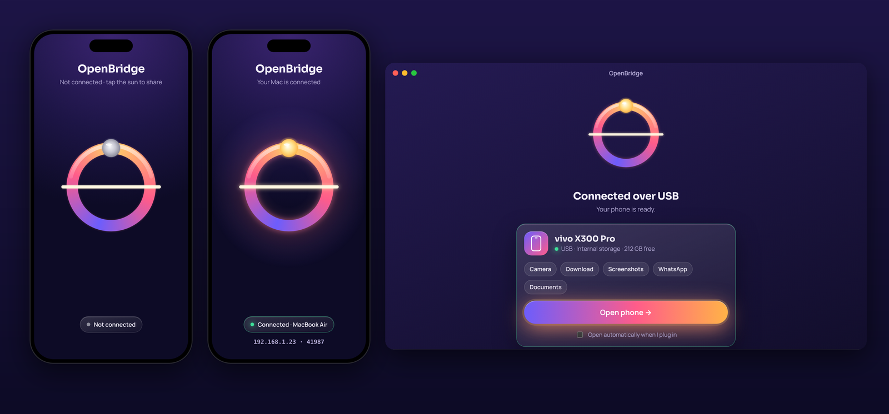
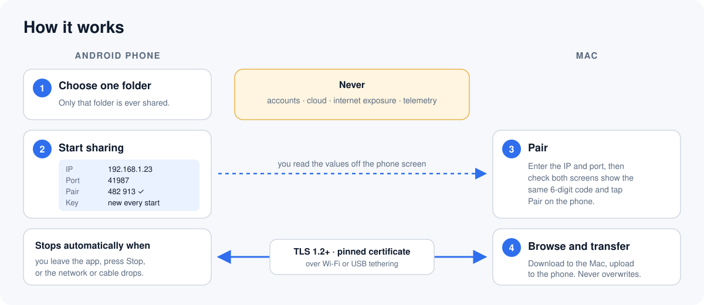

<p align="right"><a href="README.zh-CN.md">简体中文</a></p>

<p align="center"></p>

# OpenBridge

[](https://github.com/PredatorWoah/OpenBridge/releases/latest)
[](LICENSE)


**OpenBridge is a free, open-source way to move files between an Android phone and a Mac or Windows PC.** Plug in a cable and your Mac opens your phone, like on Windows. Or tap the sun on your phone and pair over encrypted Wi‑Fi with a 6‑digit code. Everything stays between your two devices: no accounts, no cloud, no tracking.

- 🔌 **Plug in and it opens.** Choose File transfer on the phone and the Mac app finds it by itself, with shortcuts straight to Camera, Download, Screenshots, WhatsApp or Documents. No driver, no kernel extension, no macFUSE.
- ☀️ **Tap the sun to share over Wi‑Fi.** The arch from the icon is the button. It turns gold when your Mac connects, by Wi‑Fi or by cable.
- 🔒 **Encrypted, with 6-digit pairing, once.** Every Wi‑Fi request uses TLS. Pair once by checking that both screens show the same 6-digit code, like Bluetooth; after that your computer reconnects by itself whenever the phone is sharing. Forget a computer anytime on the phone.
- 📁 **One folder or the whole phone**, your choice. Sharing can keep running in the background, with a notification to stop it.
- 📶 **No addresses to type.** Phones sharing on your Wi‑Fi show up by themselves, and a phone you paired before connects on its own.
- 🗂️ **A real file browser.** Thumbnails and a grid view, Quick Look with the space bar, folder sizes, search, a photos-and-videos filter, sorting, multi-select, whole folders both ways, drag and drop, new folders, and rename and delete (with a confirmation).
- 📤 **Send from the phone.** In the gallery or any app, tap Share › OpenBridge: the files land in Downloads/OpenBridge on your computer.
- 📸 **Import new photos.** One click copies only the camera photos and videos you haven't imported yet.
- 📋 **Shared clipboard.** Send text from computer to phone and back.
- 📺 **Screen mirroring (beta).** See and control your phone in a window on your computer, powered by [scrcpy](https://github.com/Genymobile/scrcpy). Start on the cable, then **go wireless** and unplug.
- 🐘 **Big files are fine.** Files of 4 GB and more work both ways. Interrupted downloads and uploads carry on from where they stopped. A 7.83 GB file has been copied from a real phone.
- 🪟 **Now on Windows too (beta).** A Phone Link alternative that works with any Android phone, Xiaomi, OPPO, vivo, OnePlus and Honor included, with no Microsoft account. In English and 简体中文.
- 🔔 **Tells you about updates.** Each app checks GitHub once per launch and shows a link when a new version is out.
- 🛡️ **Never overwrites.** Existing files are never replaced on either side; copies get a new name like "photo 2.jpg".

**Download:** get the Android APK, the Mac app (`.dmg`) and the Windows installer (`-Windows-Setup.exe`, or the portable `-Windows.zip`) from the [latest release](https://github.com/PredatorWoah/OpenBridge/releases/latest). See the [changelog](CHANGELOG.md) for what's new.

> **Status: preview, tested on real hardware.** Verified on a vivo X300 Pro and a MacBook Air M1, including a 7.83 GB USB download, plus a full automated test suite with a simulated phone and real Java/Swift TLS interoperability. USB File transfer stays **beta** until more phone brands are tested. See [verification status](docs/verification.md).

## How it works





## Why OpenBridge

Apple and Android don't talk to each other out of the box, so most Mac users end up with a paid app, a cloud service, or Google's old Android File Transfer, which Google has discontinued. Here is where OpenBridge stands.

**Better than most paid options at:**

| | OpenBridge | Typical paid apps |
| --- | --- | --- |
| Price | Free forever, MIT licensed | Subscription or a paid licence, often with a limited free tier |
| Your data | Stays on your devices. No account, no cloud relay, no analytics | Many need an account or route files through their servers |
| Cable and Wi‑Fi | Both, in one app | Usually one or the other |
| Wi‑Fi security | TLS with a pinned certificate and Bluetooth-style code pairing | Often a plain web page or an account login |
| System changes | None: no drivers, kernel extensions or macFUSE | Some mounters need extra system components |
| Safety | Never overwrites a file; partial uploads are removed | Varies; overwrite prompts are easy to click through |
| Trust | Every line is public and reviewable | Closed source |
| Extras | Clipboard sharing and screen mirroring included | Often separate apps or paid add-ons |
| Size | A few MB, native on Apple Silicon and Intel | Often much larger |

**What it lacks compared with paid apps (stated plainly):**

- **No Finder drive.** Your phone opens in OpenBridge's own window, not as a disk in Finder's sidebar. That needs Apple's File Provider system and a paid Apple developer account; it is on the list after 1.0.
- **No sync or backup.** It moves files you choose; it doesn't mirror folders or back up the phone.
- **No notifications or SMS on the Mac.** Clipboard and mirroring are in; messages are deliberately out.
- **Mirroring needs USB debugging** turned on in the phone's Developer options, and starts on the cable (it can then continue over Wi‑Fi).
- **Not notarized and not on Google Play (yet).** macOS asks you to confirm the first launch, and Android asks you to allow installing the APK.
- **Dragging files out to Finder** downloads them first, so large files take a moment before they appear.
- **Young.** Tested on one phone and one Mac so far. Reports from other phones are very welcome.

## On Windows (beta)

Microsoft's Phone Link needs a Microsoft account, works best with Samsung and Honor, and often can't connect to phones from Chinese brands or without Google services. OpenBridge for Windows needs none of that: it talks straight to the OpenBridge app on your phone over your own Wi‑Fi.

1. Download `OpenBridge-<version>-Windows-Setup.exe` and run it. It installs for your account only (no administrator prompt) and adds OpenBridge to the Start menu and desktop. Prefer no installer? Unzip `OpenBridge-<version>-Windows.zip` anywhere and run `OpenBridge.exe`. The app isn't code-signed yet, so if SmartScreen says *Windows protected your PC*, click **More info › Run anyway**. Allow it on private networks if the firewall asks.
2. Tap the sun on the phone. It appears under **Phones nearby** (if it doesn't, set your Wi‑Fi to *Private* in Windows settings, or type the address the phone shows); click it, check that both screens show the same 6 digits, and tap **Pair** on the phone.
3. Browse with thumbnails, sort, select with Ctrl and Shift, download files or whole folders, drop files onto the window to upload, and use **⋯** for new folders and the clipboard. Interrupted downloads continue where they stopped.

**By cable:** choose File transfer on the phone and OpenBridge offers **Open in File Explorer**, where Windows shows the phone like a USB drive. **Mirror screen** shows and controls the phone in a window with the built-in scrcpy, after you turn on USB debugging (see [Screen mirroring](#screen-mirroring-beta)).

The Windows app follows Windows' display language: English or Simplified Chinese. It needs 64-bit Windows 10 or 11 and includes its own Java runtime.

## Requirements

- Android 8.0/API 26 or later, private IPv4 Wi-Fi or USB tethering (see below), and a writable folder in internal storage or an SD card.
- A Mac (Apple Silicon or Intel) with macOS 13 or later, or a 64-bit Windows 10 or 11 PC. Both devices must be reachable on the same local network; guest Wi-Fi/client isolation can prevent connections.
- Development: JDK **17**, Gradle **8.13**, Android SDK platform **35**, and Android Studio or the command-line SDK. Mac builds need Xcode command-line tools/Swift 5.9 or later. These tools and dependency downloads are build-time requirements only.

## Install a release

1. **Android:** download `OpenBridge-<version>.apk` from the release onto your phone and open it. Allow installing from your browser or file manager when asked.
2. **Mac:** download `OpenBridge-<version>-macOS.dmg`, open it, and drag OpenBridge onto the Applications folder. The app is not notarized, so the first time, right-click it and choose **Open**, then **Open** again. If macOS says the app is damaged, run `xattr -dr com.apple.quarantine /Applications/OpenBridge.app` in Terminal.

## Build from source

```sh
git clone https://github.com/PredatorWoah/OpenBridge.git
cd OpenBridge
# Install Gradle 8.13 using your package/version manager, or its official distribution.
# No unverified Gradle wrapper binary is checked into this repository.
# Set ANDROID_HOME to your SDK, or set sdk.dir in local.properties.
gradle :android:app:assembleDebug
adb install -r android/app/build/outputs/apk/debug/app-debug.apk
```

Alternatively, open the repository root in Android Studio and select Gradle 8.13 as the local Gradle installation. Use JDK 17 for Gradle. Install SDK 35 when prompted; run the `android.app` application configuration on a phone. Android Studio may offer to generate its own wrapper.

On a Mac:

```sh
bash scripts/build-macos.sh
open macos/build/OpenBridge.app
```

The script makes an application bundle with a **local ad-hoc signature**. It does not notarize or publish a binary. You can also open `macos/Package.swift` in Xcode and run the OpenBridge executable. Allow local network access if macOS prompts. CI produces a debug APK and an ad-hoc signed Mac app artifact on successful builds; neither is a production release.

## Transfer files

1. Put both devices on the same trusted LAN. Open Android OpenBridge and pick what to share:
   - **Whole phone** (the default): allow *All files access* for OpenBridge when Android asks (Settings → Apps → Special app access → All files access). The Mac then sees all of internal storage and any SD card. Android keeps `Android/data` and `Android/obb` private to each app.
   - **One folder**: select a folder under internal storage or the SD card in the system picker. Android disallows some roots; use a subfolder such as `Documents/OpenBridge`. Cloud providers are rejected.
2. **Tap the sun.** It circles the arch while sharing starts, then the phone shows its address and port. With **Keep sharing in the background** on (the default), you can leave the app: a notification shows that sharing is on and has a Stop button.
3. On the Mac, click **Pair over Wi‑Fi**. Your phone appears under **Phones nearby**; click it (or type the address and port) and press **Pair**. Both screens show a 6-digit code: tap **Pair** on the phone **only if they match**. If they differ, tap Cancel; another device may be trying to connect. When pairing succeeds the sun lights up gold on both devices.
4. Click **Open phone** to browse:
   - Double-click a folder to open it; click the path to go back. Switch between list and grid, sort by name, size or kind, search the folder, or show only photos and videos. Folders show their total size over Wi‑Fi.
   - Select files (⌘-click and ⇧-click work like Finder, ⌘A selects all) and press **Download**. Several files or folders go into a folder you choose, keeping the folder structure.
   - Drop files or folders from Finder onto the window to upload them, or use **⋯ › Upload…**. Drag a file out to Finder to copy it.
   - Press the space bar to Quick Look a photo, video or document.
   - Right-click to **Rename…** or **Delete…**, or press ⌘⌫ to delete. OpenBridge asks first: the phone has no bin.
   - **⋯ › New Folder…**, and **⋯ › Send Mac clipboard to phone / Copy phone clipboard to Mac** (over Wi‑Fi; reading the phone's clipboard needs OpenBridge on screen on the phone).
   - Progress shows in the bar at the bottom. If a transfer is interrupted, **Resume** continues it, picking up a download where it stopped. If the phone was unplugged or disconnected, reconnecting it continues the transfer by itself.
5. Press **Stop sharing** on Android (in the app or the notification) when finished. Losing or changing Wi-Fi, or unplugging a USB tethering cable, also stops sharing. Your computer stays paired: next time you tap the sun, it reconnects by itself. To stop a computer from reconnecting, tap **Trusted computers** on the phone and **Forget** it.

Existing filenames are rejected on both sides, before any data is transferred. On Android, names are compared ignoring case (`Photo.JPG` collides with `photo.jpg`), and the characters `" * : < > ? |` are not allowed. Choose another name (rename the source before upload). Downloads use temporary sibling files; uploads use temporary SAF documents and publish only after the declared body is received. On a normal disconnection/cancellation, partial files are removed. After a process kill or power loss, remove any leftover `.openbridge-part-*` Android documents (hidden from the Mac's file list) or `.openbridge-*.part` Mac files manually. A cancellation exactly at upload completion can mean the phone committed the file before the Mac received its acknowledgement; refresh before retrying.

### Over a USB cable (File transfer, like on Windows) · beta

No app or pairing is needed on the phone for this. **Beta:** it has passed automated tests against a simulated phone but not yet on real phones. Please report your phone model if it is not found or a transfer fails.

1. Plug the phone into the Mac and unlock it.
2. Pull down the notification shade, tap the **USB** notification (often "Charging this device via USB"), and choose **File transfer**.
3. Open the Mac app. It notices the phone by itself: the sun whips around, lights up, and a card for your phone appears. Click **Open phone**, or a shortcut such as **Camera** or **Download**. Tick **Open automatically when I plug in** to skip the card next time.

Good to know:

- If Photos, Image Capture, Android File Transfer, OpenMTP or a similar app is using the phone, the Mac app cannot open it. OpenBridge releases it from macOS's background photo import service automatically; quit any other such app.
- Files are never replaced. Names are compared ignoring case, like the phone's storage does.
- Large files work both ways, including files of 4 GiB and more. Uploads check the phone's free space first.
- Keep the phone unlocked. Some phones close the connection when the screen locks.

### Send from the phone

In the gallery, Files or any app, select photos or files and tap **Share › OpenBridge**. If your computer is connected (or connects later), they land in **Downloads/OpenBridge**, and the phone drops its copy once they've arrived. If sharing is off, OpenBridge starts it (whole phone mode) or asks you to tap the sun. Files waiting to send are listed on the phone's main screen.

### Import new photos

Click **Import new photos** on the phone's card (Mac) or in the **⋯** menu. The first time, pick a folder. OpenBridge copies the camera's photos and videos (DCIM/Camera) that it hasn't imported from that phone before, and remembers them, so next time only the new ones come over. It works over Wi‑Fi, and on the Mac over USB too.

### Screen mirroring (beta)

See your phone's screen in a window on the Mac and use it with the mouse, trackpad and keyboard. It runs the open-source [scrcpy](https://github.com/Genymobile/scrcpy) server on the phone, built into OpenBridge, so there is nothing else to install.

1. Once: turn on USB debugging. On the phone, open Settings › About phone and tap **Build number** seven times, then Settings › System › Developer options › **USB debugging**.
2. Plug in the phone, open it in OpenBridge, and click **Mirror screen** in the sidebar.
3. The first time, the phone asks **Allow USB debugging?** Tick *Always allow from this computer* and tap **Allow**.
4. Want it without the cable? Click **Go wireless** under the screen: the phone switches to Wi‑Fi and you can unplug. Closing the window switches the phone back to cable-only debugging. Use it on a network you trust (see [SECURITY.md](SECURITY.md#screen-mirroring-usb-debugging)).

Click to tap, drag to swipe, scroll to scroll, and type with the keyboard. If the picture ever stalls, it recovers on its own within a second. Right click is Back, and the buttons below the screen are Back, Home, Recent apps, volume, power and rotate. Text you copy on either side is copied to the other. USB debugging gives a trusted computer broad control of the phone; see [SECURITY.md](SECURITY.md#screen-mirroring-usb-debugging) and turn it off when you don't need mirroring.

### Wi-Fi vs USB File transfer

| | Wi-Fi (and USB tethering) | USB File transfer |
| --- | --- | --- |
| Needs the Android app | Yes | No |
| What the Mac can see | The folder you picked, or the whole phone if you chose **Whole phone** | Everything Android shares in File transfer mode (usually all of internal storage and the SD card) |
| Protection | TLS, paired by matching a 6-digit code | The cable and your choice of File transfer on an unlocked phone; no encryption, as with any USB file transfer |
| Stops when | You press Stop sharing (or leave the app, if background sharing is off), or the network drops | You unplug, lock the phone (on some phones), or choose another USB mode |

Choose File transfer only on a Mac you trust, and switch the phone back to *No data transfer* when you are done.

### Over a USB cable with tethering (alternative)

This uses the OpenBridge Android app and the same encrypted protocol as Wi-Fi, over the cable.

1. Plug the phone into the Mac and switch on *USB tethering* (usually under Settings → Network → Hotspot & tethering). Return to OpenBridge.
2. Tap the sun. When tethering is on, OpenBridge prefers the cable over Wi-Fi.
3. Pair on the Mac exactly as above, using the IP and port on the phone. Wi-Fi is not needed.

Limitations, stated plainly:

- **Android does not let apps turn on tethering**, so you switch it on yourself each time you plug in.
- **macOS supports NCM tethering** (used by most Android 11+ phones, including Pixels) but **not RNDIS**, which many older phones and some Samsung models still use. If the Mac never shows a new network interface (System Settings → Network) after tethering is on, your phone uses RNDIS and USB mode will not work on a Mac. Use Wi-Fi.
- Some carriers block tethering entirely.
- Tethering also shares the phone's internet, and macOS may route its traffic through it, **using mobile data**. Put Wi-Fi above the phone in System Settings → Network → ⋯ → Set Service Order, or turn off mobile data while transferring.

If a connection fails, check that sharing is still on, copy the current port/credentials, allow local network access on Mac, and disable Wi-Fi client isolation. Public IPs, hostnames, IPv6, cellular-only connections, and VPN interfaces are intentionally unsupported. Do not forward the port or tunnel the server to the internet.

## Development and checks

```sh
bash scripts/test-protocol.sh             # JDK 17+, no external test dependencies
python3 scripts/test-tls.py               # real Java TLS server + stdlib Python client
python3 scripts/check-repository.py       # XML/plist, source and repository checks
gradle :protocol:check :android:app:assembleDebug :android:app:lintDebug
swift test --package-path macos           # on macOS; interop test requires fixture below
gradle -PdesktopOnly :windows:test :windows:run   # the Windows app (also runs on Linux and macOS for development)
```

To run the actual Java-server/Swift-client TLS interoperability test on a Mac:

```sh
bash scripts/test-protocol.sh
keytool -genkeypair -alias fixture -keyalg RSA -keysize 2048 -storetype PKCS12 \
  -keystore /tmp/openbridge-fixture.p12 -storepass test-only -keypass test-only \
  -dname CN=OpenBridge-CI -validity 1
FIXTURE_CLASSPATH="$PWD/build/protocol-tests" \
FIXTURE_KEYSTORE=/tmp/openbridge-fixture.p12 swift test --package-path macos
rm /tmp/openbridge-fixture.p12
```

The integration test is explicitly skipped when fixture variables are missing. CI supplies them. CI builds and lints Android on Linux and builds/tests the SwiftUI app on macOS. See [protocol](docs/protocol.md), [security](SECURITY.md), and the [device checklist](docs/verification.md).

## Structure and scope

- `protocol/`: small Java streaming handler and storage interface, executable tests, CI-only TLS fixture. No Android dependencies.
- `android/app/`: Kotlin/Compose UI, local Wi-Fi/USB-tethering listener, AndroidKeyStore TLS identity, SAF-backed storage.
- `macos/`: SwiftUI app, independent Swift wire codec, pinned TLS channel, streaming transfers, USB File transfer (MTP) and a native ADB client for mirroring, with tests.
- `third_party/scrcpy/`: license and pinned checksum of the scrcpy server bundled for mirroring.
- `windows/`: Kotlin Compose for Desktop app for Windows (Wi‑Fi client, discovery, scrcpy for mirroring), sharing the sun animation in `shared/compose` with Android.
- `docs/`: protocol contract, limitations, and manual verification.

The `Store` interface separates document access from wire handling; `BridgeCore` separates networking from the Mac UI. Remote deletion, notifications and folder sync are deliberately not implemented.
