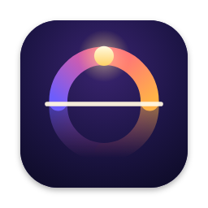
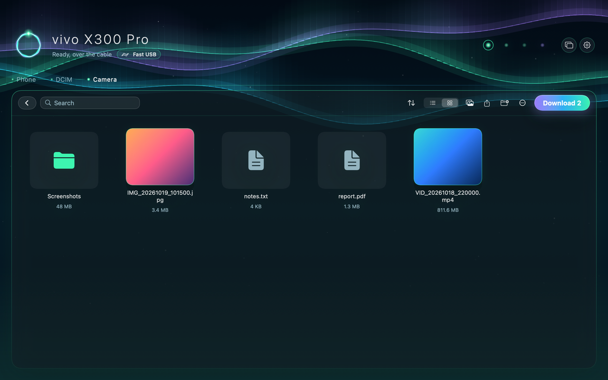
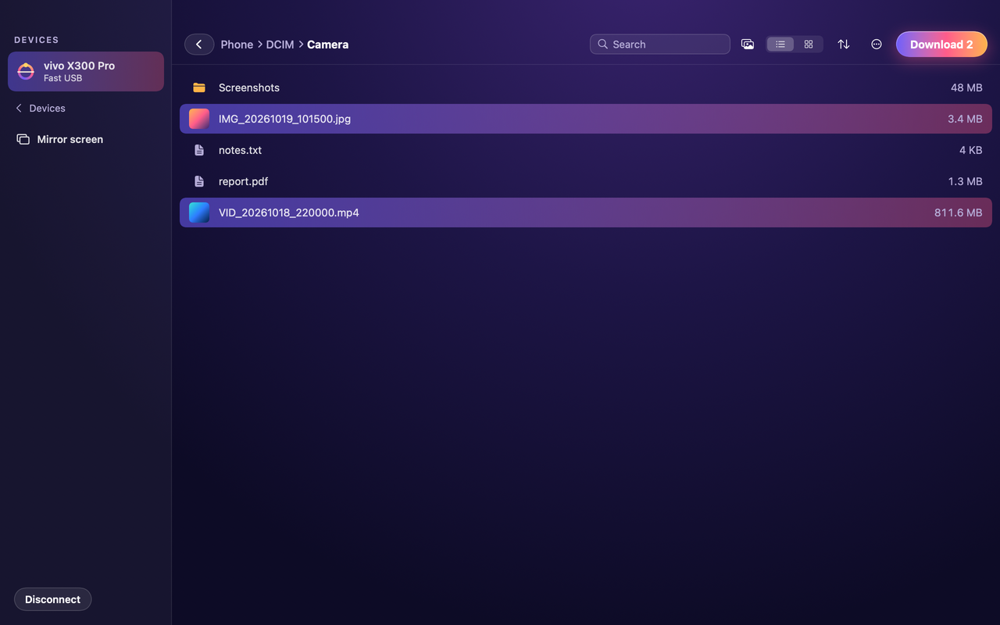
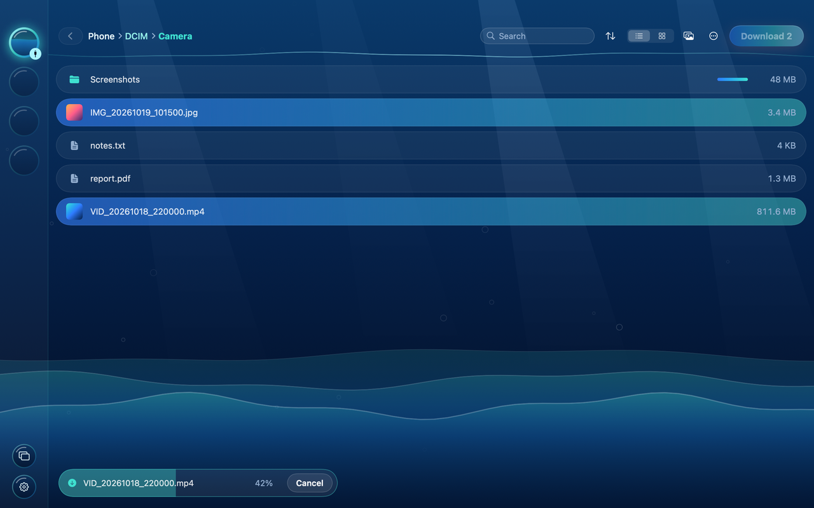
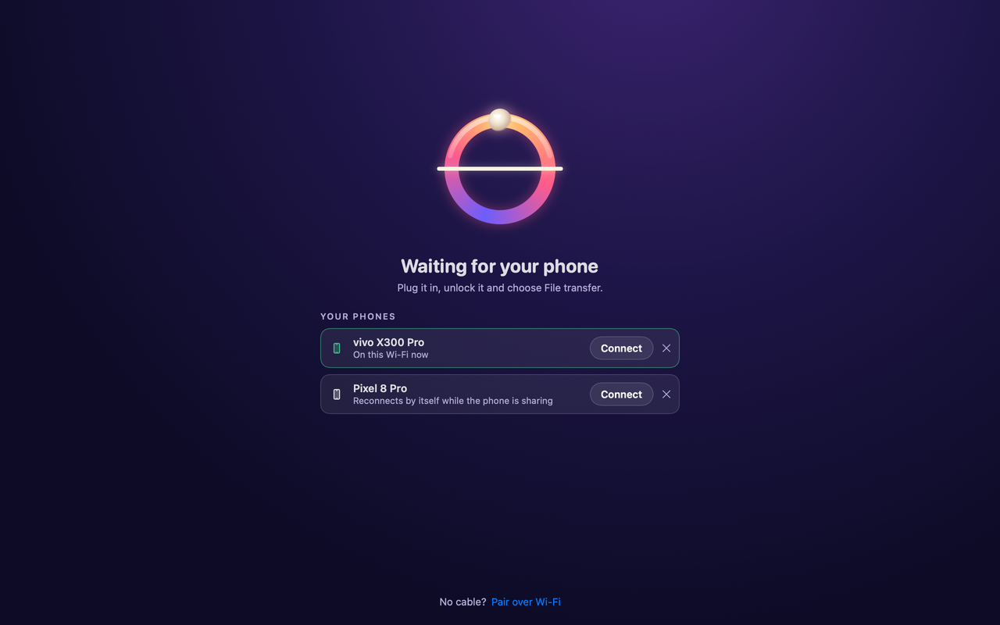
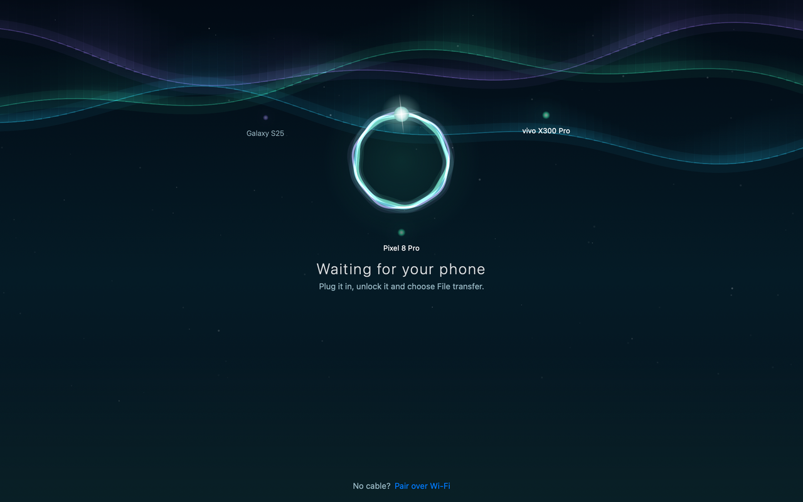
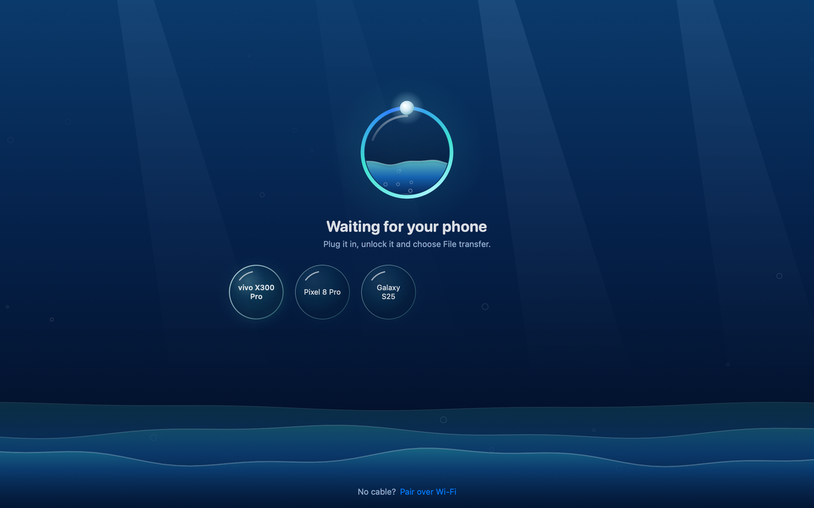
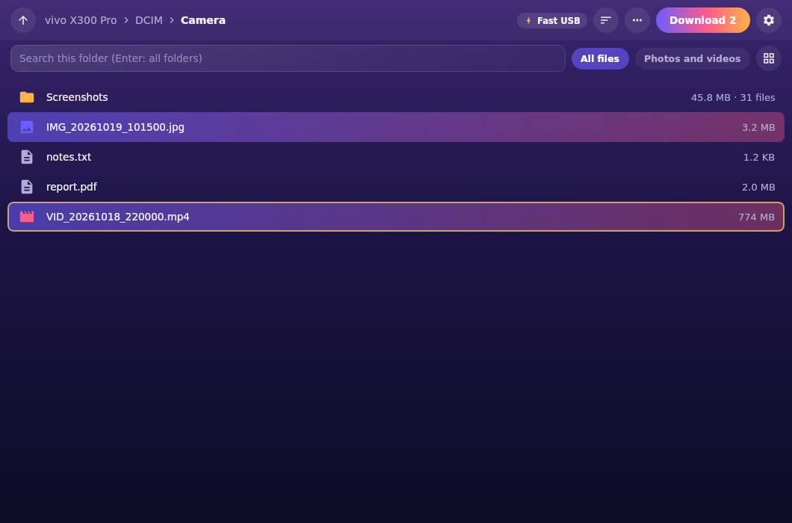
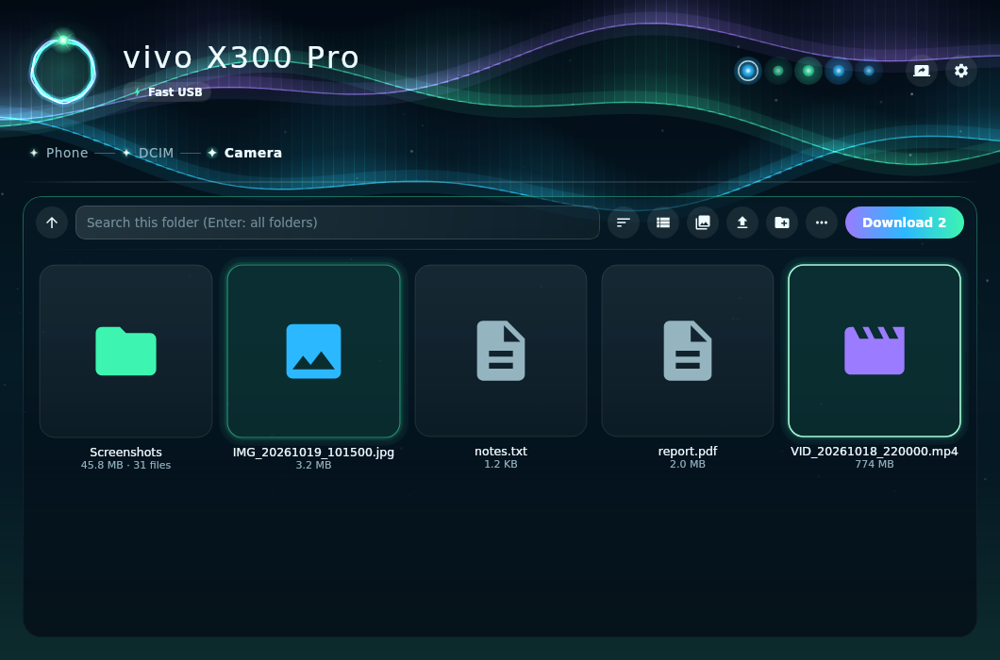
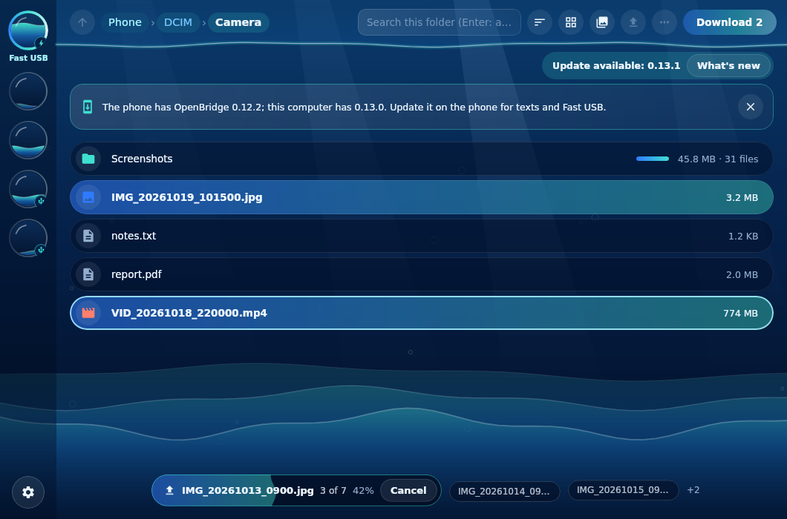

<a href="README.md">English</a>

# OpenBridge

**OpenBridge 在安卓手机和 Mac、Windows 电脑或 Linux 电脑之间传文件和文字。** 免费、开源、私密：无需账号，不经云端，没有追踪。所有内容都通过你自己的 Wi‑Fi 或数据线，直接从一台设备传到另一台。

## 为什么不用“手机连接”（Phone Link）？

微软的“手机连接”需要微软账号，主要照顾三星和荣耀，许多国产手机或没有谷歌服务的手机经常连不上。OpenBridge 不需要这些，支持任何安卓 8.0 以上的手机：小米、OPPO、vivo、一加、荣耀、realme、魅族等都可以，不依赖谷歌服务。

- 🔌 **插上就能打开**：在手机上选择“文件传输”，Mac 和 Windows 版会直接在 OpenBridge 自己的窗口里打开手机，并提供相机、下载、截屏、微信/WhatsApp、文档等快捷入口。无需驱动。
- ⚡ **高速 USB**：打开一次 USB 调试后，数据线也能享有 Wi‑Fi 的全部功能：秒出的搜索、真实的文件夹大小、中断后可继续的传输。
- ☀️ **点一下就能通过 Wi‑Fi 共享**：在手机上点一下大按钮，电脑会自动找到手机。第一次核对两边的 6 位数字配对，之后会自动重新连接。
- 🔒 **加密并固定证书**：每个 Wi‑Fi 请求都走 TLS，并固定手机的证书；每台电脑都有自己的密钥，随时可以在手机上移除。
- 🗂️ **好用的文件浏览器**：缩略图和网格视图、排序、多选、整个文件夹双向传输、拖放、新建文件夹、重命名和删除、文件夹大小，以及在整部手机中搜索。照片和视频能瞬间搜到。
- 📤 **从手机发送**：在任意应用中点“分享 › OpenBridge”，照片和文件会保存到电脑的“下载/OpenBridge”。大视频直接从原位置发送，不会额外复制一份占用空间。
- 💬 **文字和剪贴板**：把文字分享给 OpenBridge、点快捷设置里的“发送剪贴板”，或在电脑上输入后发到手机，内容会出现在另一边的剪贴板上，并保留收发记录。还可以选择让电脑上复制的文字自动发到手机。
- 📸 **导入新照片**：一键只导入还没导入过的相机照片和视频。
- 📺 **投屏控制**：内置开源的 [scrcpy](https://github.com/Genymobile/scrcpy)，用鼠标键盘操作手机。先用数据线连接，然后可以切换到 Wi‑Fi，拔掉数据线。
- 📶 **应对受限的 Wi‑Fi**：酒店、校园和访客网络常常把设备隔开。OpenBridge 会发现这种情况，并提供绕过的办法：使用手机热点，或者用数据线。
- 🎨 **三种外观，三种布局**：经典的“黄昏”、北极光下的天文台“极光”、水位随传输上涨的港湾“潮汐”。在 Mac、Windows、Linux 和手机上各有自己的动画布局。
- 🐘 **大文件没问题**：4 GB 以上的文件双向都能传，中断后从断点继续。
- 🛡️ **从不覆盖文件**：两边已有的文件都不会被替换。
- 🔔 **一键更新**：有新版本时，点一下就会下载、用发布页的校验值核对，然后安装。
- 🌏 **中文界面**：手机端、Windows 版和 Linux 版都会跟随系统语言显示简体中文。

## 下载

所有安装包都在[最新版本](https://github.com/PredatorWoah/OpenBridge/releases/latest)页面，更新内容见[更新日志](CHANGELOG.md)（英文）。

| 设备 | 文件 | 安装方法 |
| --- | --- | --- |
| 安卓 8.0 及以上 | `OpenBridge-<版本>.apk` | 在手机上打开，按提示允许浏览器或文件管理器安装应用。 |
| Mac，macOS 13 及以上（Apple 芯片和 Intel） | `OpenBridge-<版本>-macOS.dmg` | 打开后把 OpenBridge 拖到“应用程序”。应用未经公证，第一次请右键点应用 › **打开** › **打开**。如果提示“已损坏”，在终端运行 `xattr -dr com.apple.quarantine /Applications/OpenBridge.app`。 |
| Windows 10 或 11（64 位） | `OpenBridge-<版本>-Windows-Setup.exe` | 运行即可，只为当前用户安装，不需要管理员权限。应用暂未进行代码签名，如果 SmartScreen 提示“Windows 已保护你的电脑”，请点 **更多信息 › 仍要运行**。不想安装？解压 `-Windows.zip` 后运行 `OpenBridge.exe`。 |
| Linux（x86-64） | `OpenBridge-<版本>-Linux-amd64.deb` 或 `-Linux-x86_64.tar.gz` | Debian 和 Ubuntu 上运行 `sudo apt install ./OpenBridge-<版本>-Linux-amd64.deb`，或把 tar.gz 解压到任意位置后运行 `OpenBridge/bin/OpenBridge`。 |

每个版本都在 `SHA256SUMS.txt` 中列出文件的 SHA-256，APK 使用 OpenBridge 的签名密钥签名，指纹见 [SECURITY.md](SECURITY.md#verifying-downloads)。

## 开始使用

1. **在手机上** 打开 OpenBridge，点一下大按钮。第一次请允许“所有文件访问权限”（也可以只共享一个文件夹）。
2. **在电脑上** 打开 OpenBridge，手机会出现在“附近的手机”中，点它。
3. **核对两边的 6 位数字**，一样就在手机上点“配对”。完成！可以浏览、拖入拖出文件，下次会自动连接。

想用数据线？插上手机、解锁并选择“文件传输”，Mac 和 Windows 版会直接打开，无需配对。

## 三种外观，各有各的布局

在每台设备的设置中选择外观。“黄昏”是经典的落日风格。**极光**像一座天文台：你的手机是天空标题栏里的星星，文件夹路径沿着地平线延伸，彗星带着传输进度划过，文件漂浮在一块玻璃面板上。**潮汐**像一座港湾：手机是一个个舷窗，文件是被选中时会注满水的胶囊，传输时水位会随之上涨。

<table>
<tr><th></th><th>黄昏</th><th>极光</th><th>潮汐</th></tr>
<tr><td><b>Mac</b></td>
<td></td>
<td></td>
<td></td></tr>
<tr><td><b>Mac，等待连接</b></td>
<td></td>
<td></td>
<td></td></tr>
<tr><td><b>Windows 和 Linux</b></td>
<td></td>
<td></td>
<td></td></tr>
<tr><td><b>手机</b></td><td colspan="3"></td></tr>
</table>

## 连接方式

| | Wi‑Fi | USB 数据线（文件传输） | 高速 USB | 手机热点 |
| --- | --- | --- | --- | --- |
| 设置 | 用 6 位数字配对一次 | 无需设置：选择“文件传输” | 打开一次 USB 调试 | 在手机应用中打开（安卓 13+） |
| 需要手机应用 | 是 | 否 | 是 | 是 |
| 速度 | 取决于 Wi‑Fi | 数据线 | 数据线 | 手机的 Wi‑Fi |
| 搜索和文件夹大小 | 瞬间完成 | 通过数据线统计 | 瞬间完成 | 瞬间完成 |
| 文字、从手机发送、断点续传 | 支持 | Mac：下载可续传 | 支持 | 支持 |
| 加密 | TLS | 否（和所有 USB 文件传输一样） | TLS | TLS |
| 电脑 | Mac、Windows、Linux | Mac、Windows | Mac、Windows、Linux | Mac、Windows、Linux |

**高速 USB** 通过安卓的 USB 调试，在数据线上运行和 Wi‑Fi 相同的加密连接。打开一次即可：设置 › 关于手机 › 连续点 7 次 **版本号**，然后在开发者选项中打开 **USB 调试**。插上手机，在手机上点 **允许**，OpenBridge 会自动在手机上开始共享并切换到高速 USB，不需要 Wi‑Fi。

**手机热点** 适合会把设备隔开的网络（酒店、办公室、校园和访客 Wi‑Fi 常常这样）。在手机上打开 **设置 › 手机热点**，让电脑连接它显示的网络，就能连上。安卓 12 及以下，这个按钮会打开系统的热点设置。

**USB 网络共享** 也可以：在手机上打开后点按钮，OpenBridge 会优先使用数据线。macOS 不支持部分手机使用的 RNDIS 网络共享，在 Mac 上请改用“文件传输”或高速 USB。

## 功能

### 浏览和传输

双击打开文件夹，在列表和网格之间切换，按名称、大小或类型排序，或只看照片和视频。文件夹大小会在手机统计后显示。按住 Ctrl（Mac 上是 ⌘）或 Shift 多选后点 **下载**；多个项目会保留文件夹结构，保存到你选的位置。把文件或文件夹拖进窗口即可上传。在右键或 **⋯** 菜单中重命名和删除（删除前会确认，因为手机没有回收站）。也可以用键盘：方向键、回车打开、退格返回上一级、Delete 删除、F2 重命名、Ctrl/⌘+A 全选。

**搜索** 会查找当前文件夹及其所有子文件夹：输入后按回车。照片、视频和音乐会通过手机自己的索引瞬间找到，其他文件几秒内出来。

传输中断时，点 **继续** 会从断点接着传，重新连接后也会自动继续。

### 从手机发送

在相册、文件管理或任意应用中选择照片或文件，点 **分享 › OpenBridge**。电脑连接后（或下次连接时），文件会保存到电脑的 **下载/OpenBridge**。如果还没开始共享，OpenBridge 会自动开始。大视频直接从原位置发送，分享 4 GB 的视频不需要 4 GB 的空闲空间。

### 文字和剪贴板

- **手机到电脑：** 在任意应用中把文字分享给 OpenBridge，或点快捷设置中的 **发送剪贴板**（应用里和共享通知中也有这个按钮），文字随即出现在电脑的剪贴板上。
- **电脑到手机：** 打开 **文字**，输入或粘贴后点 **发送**，或者 **发送剪贴板**。打开 **自动把复制的文字发到手机** 后连按钮都不用点。
- 两边都保留最近的文字记录，每条都可以一键复制。内容只在你的两台设备之间传递。

### 导入新照片

点手机卡片上或 **⋯** 菜单中的 **导入新照片**，会把还没从这部手机导入过的相机照片和视频复制到你第一次选择的文件夹，并记住已导入的内容。

### 投屏控制

在窗口中看到手机画面，并用鼠标和键盘操作，内置开源的 [scrcpy](https://github.com/Genymobile/scrcpy)。打开 USB 调试（和高速 USB 一样），插上手机后点 **投屏控制**。然后点 **无线投屏**（Mac）或 **通过 Wi‑Fi 投屏**（Windows、Linux），就可以拔掉数据线。在任一边复制的文字会同步到另一边。USB 调试会让受信任的电脑获得很大的权限，详见 [SECURITY.md](SECURITY.md#screen-mirroring-usb-debugging)，不用时请关闭。

### 外观

在每台设备的设置中选择 **黄昏**、**极光** 或 **潮汐**（见上方截图）。在电脑上，每种外观都有自己的布局，而不只是换颜色；切换外观时，当前文件夹、选择和传输都会保留。在手机上，极光的光带在星空中飘动，潮汐的玻璃水池会在电脑连接时注满水。极光和潮汐仍标注为预览，欢迎告诉我们你的想法。开启系统的“减弱动态效果”后，一切都会保持静止。

### 更新和帮助

每个应用在启动时向 GitHub 查询一次新版本。有新版本时点 **更新**，应用会下载、用发布页的 `SHA256SUMS.txt` 核对后安装（安卓上系统会请你确认）。遇到问题？**设置 › 复制诊断信息** 会复制一份不含任何密钥或文件内容的简短报告，可以粘贴到 [issue](https://github.com/PredatorWoah/OpenBridge/issues/new/choose) 中。

## 隐私和安全

OpenBridge 没有服务器。文件和文字只在你的手机和已配对的电脑之间传递，Wi‑Fi 上使用 TLS，或者直接走数据线。每个应用每次启动时会向 GitHub 发送一个匿名请求检查更新。手机只在你打开共享后才共享，后台共享时会显示通知，随时可以在手机上移除某台电脑。详细说明（包括 USB 文件传输和 USB 调试允许做什么）见 [SECURITY.md](SECURITY.md)（英文），通信协议见 [docs/protocol.md](docs/protocol.md)。

## 帮忙测试

OpenBridge 在真机上测试过（目前是 vivo X300 Pro 和 MacBook Air M1），每次修改也都会运行自动测试。不同品牌的手机在 USB 上各有差异，所以其他手机的测试报告最有帮助。[20 分钟测试清单](docs/verification.md#test-it-on-your-phone)（英文）覆盖了所有功能，完成后请提交一份[设备报告](https://github.com/PredatorWoah/OpenBridge/issues/new?template=device-report.yml)。

## 从源码构建

构建方法、检查命令和代码结构见[英文说明](README.md#build-from-source)。

## 许可证

[MIT](LICENSE)。投屏功能内置未修改的 [scrcpy](https://github.com/Genymobile/scrcpy) 服务端以及 Windows/Linux 版本（Apache-2.0），见 `third_party/scrcpy`。
